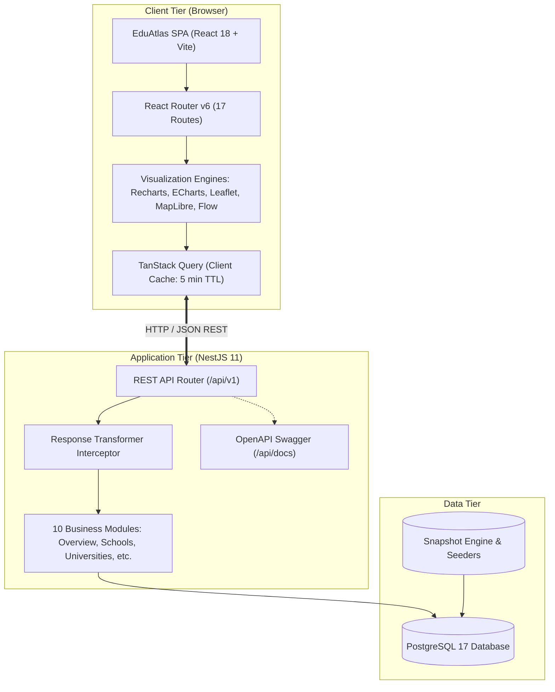
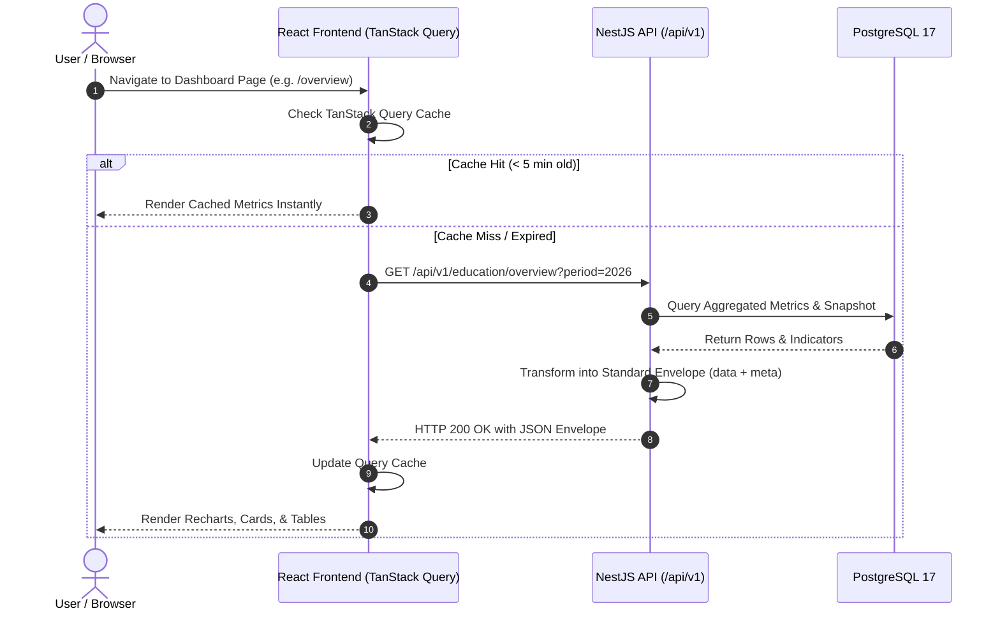

# EduAtlas — System Architecture & Engineering Guide

**Product Name:** EduAtlas  
**Document:** System Architecture & Monorepo Structure  
**Version:** 1.0.0  
**Status:** Implemented & Verified  

---

## 1. System Topology & Monorepo Organization

EduAtlas is engineered as a decoupled monorepo containing a high-performance NestJS backend and a modern React frontend:

```text
EduAtlas/
├── apps/
│   ├── backend/               # NestJS 11 REST API Application
│   │   ├── src/
│   │   │   ├── common/        # Response transformer interceptors, DTOs, filters
│   │   │   ├── config/        # Environment and database configurations
│   │   │   ├── database/      # Sequelize connection, models, and seeders
│   │   │   ├── health/        # Terminus health checks
│   │   │   ├── modules/       # 10 business domain modules
│   │   │   └── main.ts        # Bootstrap entrypoint (port 4000)
│   │   └── package.json
│   └── frontend/              # React 18 + Vite 6 Single Page Application
│       ├── src/
│       │   ├── app/           # React Router and QueryClientProvider
│       │   ├── components/    # AppShell, Sidebar, PageHeader, reusable cards
│       │   ├── features/      # 17 interactive dashboard feature modules
│       │   ├── lib/           # Centralized Axios client and formatters
│       │   ├── types/         # TypeScript contract models
│       │   ├── index.css      # Tailwind CSS v4 design tokens
│       │   └── main.tsx       # Frontend bootstrap (port 5173)
│       └── package.json
├── docs/                      # Technical documentation
│   ├── assets/                # Dedicated Documentation Visual Assets Folder
│   │   ├── brands/            # Brand Identity & Design Assets
│   │   └── screenshots/       # 12+ Dashboard full-page screenshots
│   ├── README.md              # Documentation index & guide
│   ├── product-requirements.md# Comprehensive PRD & specifications
│   ├── architecture.md        # This system architecture document
│   ├── api-contracts.md       # REST API contracts & Swagger endpoints
│   ├── database-schema.md     # PostgreSQL schema & Sequelize entities
│   └── design-system.md      # EduAtlas Design System v1.0
├── package.json               # Root monorepo workspace definition
├── .yarnrc                    # Yarn registry & timeout configuration
└── yarn.lock                  # Yarn lockfile
```

---

## 2. High-Level Architecture Diagram



---

## 3. Backend Architecture (NestJS 11)

The backend runs on **Node.js (v20+)** using the **NestJS 11** framework with Express.

### 3.1 Core Principles
* **Modular Domain Structure:** Each business entity (Schools, Universities, Geography, Analytics, Calendar, Reports) is self-contained in its own module under `apps/backend/src/modules/`.
* **Standard Response Envelope:** All outgoing HTTP responses pass through `TransformInterceptor` (`apps/backend/src/common/interceptors/transform.interceptor.ts`), wrapping data in:
  ```json
  {
    "data": {},
    "meta": {
      "snapshotId": "snp-2026-10-20",
      "snapshotDate": "2026-10-20T00:00:00.000Z",
      "period": "2026",
      "source": "EduAtlas Demo Dataset",
      "isDemoData": true,
      "pagination": { ... }
    }
  }
  ```
* **Exception Filter:** Centralized `HttpExceptionFilter` formats errors uniformly and prevents internal database stack traces from leaking to clients.
* **CORS & Security:** Cross-Origin Resource Sharing is configured to allow `http://localhost:5173` and production client domains. Security headers are applied.

### 3.2 Database Access & ORM
* **ORM:** Sequelize 6 with `sequelize-typescript` decorators.
* **Database Engine:** PostgreSQL 17.
* **Seed Strategy:** Deterministic seeding script initializes realistic Indonesian educational data across 38 provinces and 6 island clusters.

---

## 4. Frontend Architecture (React 18 + Vite)

### 4.1 Application Shell & Layout
* **AppShell:** Provides the primary viewport grid:
  * **Floating Sidebar:** Left-aligned (180–200 px), Atlas Navy background, displaying navigation icons stacked above category titles.
  * **Single-Line Header:** Combines Page Title/Breadcrumb (left), Global Filters (center), and User Profile `[AD] Andi Dharma` (right) into a single cohesive line. Notifications and redundant topbars are omitted for visual simplicity.
  * **Main Content Area:** Responsive canvas with 16–24 px page padding.
  * **Floating Export Button:** Bottom-right fixed button in Knowledge Teal for instantaneous data export.

### 4.2 State Management & Network Layer
* **TanStack Query v5:** Handles all server data caching, background revalidation, and loading/error states.
* **Stale Time:** Configured to 5 minutes to prevent unnecessary network traffic during page transitions.
* **Axios Instance:** Centralized in `apps/frontend/src/lib/api.ts` with baseURL `http://localhost:4000/api/v1`.

### 4.3 Design Tokens & Styling
Tailwind CSS v4 with custom `@theme` tokens in `apps/frontend/src/index.css`:
* Primary Brand: `--color-atlas-navy: #153B66`
* Primary Accent: `--color-knowledge-teal: #25A9A1`
* Secondary Accent: `--color-sky-cyan: #8ED8E4`
* Highlight Gold: `--color-discovery-gold: #FFC857`
* Background: `--color-background: #F5F8FC`
* Card Surface: `--color-surface: #FFFFFF`
* Text Foreground: `--color-foreground: #172B4D`

---

## 5. Data Flow & Snapshot Pipeline



---

## 6. Export Pipeline

EduAtlas supports client-side data exports that respect active page filters:
* **Excel (.xlsx):** Generated using `ExcelJS`. Generates clean tabular spreadsheets with styled summary headers, currency/number formatting, and metadata sheets.
* **PDF (.pdf):** Generated using `jsPDF`. Generates clean, printable executive summary briefs with company letterhead, snapshot provenance, and key metric cards.
* **CSV:** Generated using standard browser blob downloads for raw data exploration in TanStack Table.
