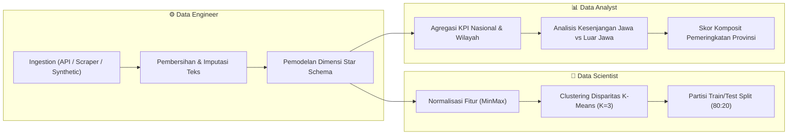

# EduAtlas Data Engineering & Analytics Documentation

Selamat datang di portal dokumentasi arsitektur data **EduAtlas Data Platform**. Dokumen ini merangkum strategi, alur kerja kolaboratif tim data (**Data Engineer**, **Data Analyst**, dan **Data Science**), serta struktur repositori data terpadu (*Medallion / Layered Architecture*).

---

## 1. Indeks Dokumentasi Data

| Dokumen | Deskripsi |
| :--- | :--- |
| [**Data Pipeline & ETL Workflow**](data-pipeline.md) | Panduan alur kerja ingestion, transformasi star-schema, pemodelan ML, dan sinkronisasi ke aplikasi. |
| [**Kamus Data (Data Dictionary)**](data-dictionary.md) | Definisi lengkap seluruh tabel, kolom, tipe data, dan rentang nilai valid dari raw hingga analytics mart. |
| [**Data Lineage & Silsilah Data**](data-lineage.md) | Diagram alur perubahan data mentah menjadi tabel fakta-dimensi, feature store, dan metrik bisnis. |

---

## 2. Struktur Direktori Data Terpadu (`data/`)

Seluruh siklus data dikelola dalam 1 folder induk yang terisolasi dan modular:

```text
data/
├── 01_raw/                      # [DE] Immutable: Data mentah persis sesuai sumber aslinya
│   ├── bps/                     # Indikator makro pendidikan BPS (IPM, APM, APK, APBD)
│   ├── kemdikbud/               # Data pokok sekolah nasional (Dapodik / Referensi)
│   └── pddikti/                 # Data perguruan tinggi, mahasiswa aktif, dan publikasi
│
├── 02_interim/                  # [DE / DA] Data hasil standardisasi awal & pembersihan teks
│   └── schools_clean.csv        # Encoding UTF-8, pembersihan whitespace, validasi format
│
├── 03_processed/                # [DE] Single Source of Truth berbasis Star Schema Data Warehouse
│   ├── dim_regions.csv          # Tabel Dimensi: 22 Provinsi di Indonesia
│   ├── dim_schools.csv          # Tabel Dimensi: 300 Entitas Sekolah Terstandarisasi
│   ├── fact_school_academics.csv# Tabel Fakta: Rasio murid-guru, akreditasi, & skor sarpras
│   └── fact_universities.csv    # Tabel Fakta: Perguruan tinggi PTN/PTS & metrik akademik
│
├── 04_features/                 # [DS] Feature Store untuk Machine Learning & Disparitas Wilayah
│   ├── train_features.csv       # 80% data latih dengan fitur terskala (240 records)
│   ├── test_features.csv        # 20% data evaluasi model (60 records)
│   ├── school_disparity_clusters.csv # Segmentasi 3-Tier K-Means Disparitas Sekolah
│   └── feature_metadata.json    # Metadata parameter, normalisasi MinMax, dan random seed
│
├── 05_analytics/                # [DA] Analytics Mart siap konsumsi Dashboard & Laporan
│   ├── overview_kpi.json        # Ringkasan KPI nasional (Siswa, Guru, Kampus, Rasio)
│   ├── regional_performance_ranking.csv # Peringkat komposit provinsi (Bobot IPM & Fasilitas)
│   ├── education_level_distribution.json# Metrik breakdown jenjang SD, SMP, SMA, dan SMK
│   ├── island_disparity_analysis.csv    # Komparasi analitik Pulau Jawa vs Luar Jawa
│   ├── disparity_3t.json        # Analisis kesenjangan 3T, radar 5 pilar SPM, & 514 Kab/Kota
│   ├── budget_efficiency.json   # Belanja per siswa & kuadran efisiensi APBD vs IPM 38 Provinsi
│   ├── forecasting_baseline.json# Kohort guru pensiun & parameter proyeksi 2026–2030
│   └── policy_brief_templates.json # 5 Draf memorandum kebijakan standar Bappenas
│
├── metadata/                    # [Semua] Tata Kelola Data & Kontrak Skema
│   ├── data_dictionary.md       # Kamus data markdown
│   ├── data_lineage.md          # Diagram alur transformasi data
│   └── schema_contracts.json    # JSON Schema kontrak validasi
│
└── pipelines/                   # [DE] Skrip Otomasi Python (Standard Library)
    ├── 01_generate_raw_synthetic.py # Ekstraksi & penarikan data mentah
    ├── 02_clean_and_transform.py    # Transformasi data warehouse
    ├── 03_generate_features_ds.py   # Feature store & clustering K-Means
    ├── 04_generate_analytics_da.py  # Agregasi analitik & ranking
    ├── 05_generate_expansion_analytics.py # Generasi dataset 5 fitur eksekutif & 514 kab/kota
    ├── sync_to_application.py       # Sinkronisasi ke Backend Snapshot & Frontend Constants
    ├── sync_expansion_to_app.py     # Sinkronisasi snapshot ekspansi baru ke aplikasi
    └── run_all_pipelines.py         # Master pipeline runner
```

---

## 3. Pembagian Peran Tim Data



---

## 4. Cara Menjalankan Pipeline & Sinkronisasi

1. **Menjalankan Seluruh Pipeline ETL & Analitik:**
   ```bash
   python data/pipelines/run_all_pipelines.py
   ```
2. **Menyinkronkan Hasil Olahan ke Aplikasi EduAtlas (Backend & Frontend):**
   ```bash
   python data/pipelines/sync_to_application.py
   ```
3. **Memperbarui Spesifikasi OpenAPI / Swagger:**
   ```bash
   python data/pipelines/generate_openapi_spec.py
   ```
