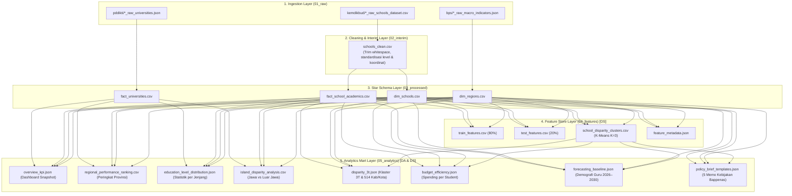

# Data Lineage — Alur Transformasi Data EduAtlas

Dokumen ini memetakan siklus hidup data mulai dari tahap *Ingestion* (Data Engineer), *Transformation & Cleaning* (DE + DA), *Feature Engineering & Clustering* (Data Scientist), hingga *Analytics Mart* (Data Analyst).

---

## Diagram Alur Data Lineage

---

## Logika Transformasi Utama

1. **Pembersihan Teks & Imputasi (DE)**:
   * String nama sekolah dan wilayah di-*strip* dari spasi liar dan diubah ke *Title Case*.
   * Nilai akreditasi kosong diimputasi dengan modus (`B`).
   * Skor fasilitas kosong diimputasi dengan median nasional (`75.0`).
2. **Normalisasi & Penskalaan Fitur (DS)**:
   * Skor fasilitas dan rasio guru-murid diskalakan ke rentang `[0.0, 1.0]` menggunakan Min-Max Scaling.
   * Algoritma K-Means ($K=3$) dijalankan pada ruang fitur 2D untuk mengelompokkan sekolah ke dalam 3 klaster disparitas.
   * Dataset diacak secara terkontrol menggunakan seed `1337` dan dipartisi menjadi $80\%$ *train* dan $20\%$ *test*.
3. **Agregasi Metrik Komposit (DA)**:
   * **Skor Komposit Kinerja Wilayah**:
     $$\text{Composite Score} = (0.4 \times \text{IPM}) + (0.4 \times \text{Rata-rata Skor Fasilitas}) + (0.2 \times \text{Persentase Akreditasi A})$$
   * Agregasi disparitas spasial memisahkan provinsi dalam gugus **Pulau Jawa** vs **Luar Pulau Jawa**.
