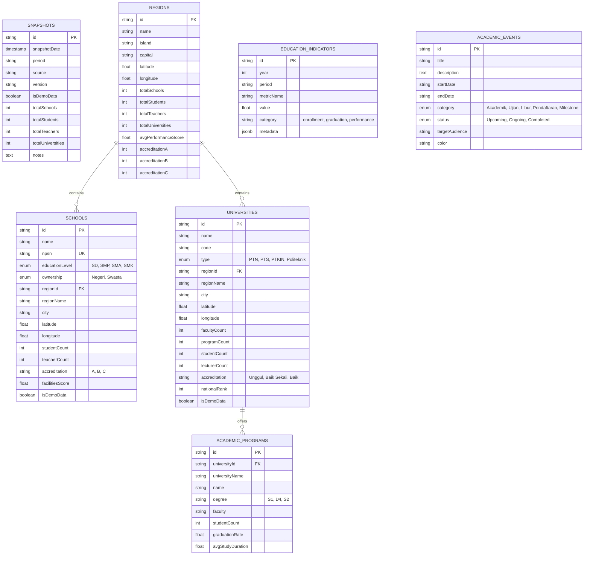

# EduAtlas — Database Schema & Entity Specification

**Database Engine:** PostgreSQL 17  
**Database Name:** `eduatlas_db`  
**ORM:** Sequelize 6 (`sequelize-typescript`)  
**Document Version:** 1.0.0  
**Status:** Models implemented; see migration and seed verification notes in [page-data-map.md](page-data-map.md).

**Application schemas:** `directory` (4 tables), `academic` (3), `analytics` (3), `system` (4).
Total: 12 data tables plus `system.schema_migrations` and `system.seed_runs`.
Migration runner applies numbered migrations without `sync({ alter: true })`.
See [per-menu and per-card mapping](page-data-map.md) for current frontend gaps.

| Schema | Tables |
|---|---|
| directory | regions, schools, universities, institution_links |
| academic | academic_programs, academic_events, timeline_programs |
| analytics | education_indicators, snapshots, report_definitions |
| system | schema_migrations, seed_runs, data_sources, data_imports |

See [five card data tables](card-data-tables.md) for migration 002, column specifications,
constraints, seed behavior and the cards API. The detailed legacy specifications below
describe the original seven domain tables.

Existing public data tables are relocated with ALTER TABLE SET SCHEMA, preserving rows,
foreign keys and indexes. Migration undo returns them to public; enum types and technical
history remain available. Seed ownership is recorded only for rows inserted by the new seeder.

---

## 1. Entity-Relationship Overview

EduAtlas uses a normalized relational model organized around administrative regions and educational snapshot metrics:

---

## 2. Table Specifications

### 2.1 Table: `snapshots`
Stores versioned metadata of educational data snapshots.
* **`id`** (`VARCHAR(255)`, Primary Key) — Unique snapshot identifier (e.g., `snp-2026-10-20`).
* **`snapshotDate`** (`TIMESTAMP`, NOT NULL) — Date and time when the snapshot was frozen.
* **`period`** (`VARCHAR(50)`, NOT NULL) — Reporting year / period (e.g., `2026`).
* **`source`** (`VARCHAR(255)`, Default: `'EduAtlas Demo Dataset'`) — Data provenance description.
* **`version`** (`VARCHAR(50)`, Default: `'1.0.0'`) — Semantic version of the snapshot schema.
* **`isDemoData`** (`BOOLEAN`, Default: `true`) — Flag indicating simulated demo data.
* **`totalSchools`** (`INTEGER`, NOT NULL, Default: `0`) — Aggregated national school count.
* **`totalStudents`** (`INTEGER`, NOT NULL, Default: `0`) — Aggregated national student count.
* **`totalTeachers`** (`INTEGER`, NOT NULL, Default: `0`) — Aggregated national teacher count.
* **`totalUniversities`** (`INTEGER`, NOT NULL, Default: `0`) — Aggregated national university count.
* **`notes`** (`TEXT`, Nullable) — Administrative snapshot notes.

---

### 2.2 Table: `regions`
Represents Indonesian provincial territories and aggregated performance benchmarks.
* **`id`** (`VARCHAR(255)`, Primary Key) — Sluggish identifier (e.g., `reg-jawa-barat`, `reg-dki-jakarta`).
* **`name`** (`VARCHAR(255)`, NOT NULL) — Province name (e.g., `Jawa Barat`).
* **`island`** (`VARCHAR(100)`, NOT NULL) — Major island cluster: `Jawa`, `Sumatera`, `Kalimantan`, `Sulawesi`, `Bali & Nusa Tenggara`, `Maluku & Papua`.
* **`capital`** (`VARCHAR(255)`, NOT NULL) — Provincial capital city (e.g., `Bandung`).
* **`latitude`** (`FLOAT`, NOT NULL) — Geographic centroid latitude.
* **`longitude`** (`FLOAT`, NOT NULL) — Geographic centroid longitude.
* **`totalSchools`** (`INTEGER`, Default: `0`) — Total registered primary/secondary schools.
* **`totalStudents`** (`INTEGER`, Default: `0`) — Total student population.
* **`totalTeachers`** (`INTEGER`, Default: `0`) — Total active teachers.
* **`totalUniversities`** (`INTEGER`, Default: `0`) — Total higher education institutions.
* **`avgPerformanceScore`** (`FLOAT`, Default: `75.0`) — Normalized quality index (0–100).
* **`accreditationA`** (`INTEGER`, Default: `0`) — Number of 'A' accredited institutions.
* **`accreditationB`** (`INTEGER`, Default: `0`) — Number of 'B' accredited institutions.
* **`accreditationC`** (`INTEGER`, Default: `0`) — Number of 'C' accredited institutions.

---

### 2.3 Table: `schools`
Directory of primary and secondary schools across Indonesia.
* **`id`** (`VARCHAR(255)`, Primary Key) — Unique identifier (e.g., `sch-001`).
* **`name`** (`VARCHAR(255)`, NOT NULL) — School name (e.g., `SMAN 8 Jakarta`).
* **`npsn`** (`VARCHAR(50)`, UNIQUE, NOT NULL) — National School Identification Number (8-digit).
* **`educationLevel`** (`ENUM('SD', 'SMP', 'SMA', 'SMK')`, NOT NULL) — Level of education.
* **`ownership`** (`ENUM('Negeri', 'Swasta')`, NOT NULL) — Public or private institution.
* **`regionId`** (`VARCHAR(255)`, Foreign Key &rarr; `regions.id`, NOT NULL).
* **`regionName`** (`VARCHAR(255)`, NOT NULL) — Denormalized province name for fast queries.
* **`city`** (`VARCHAR(255)`, NOT NULL) — Regency or city name.
* **`latitude`** (`FLOAT`, NOT NULL) — Exact institutional latitude.
* **`longitude`** (`FLOAT`, NOT NULL) — Exact institutional longitude.
* **`studentCount`** (`INTEGER`, Default: `0`) — Active enrolled students.
* **`teacherCount`** (`INTEGER`, Default: `0`) — Active teaching staff.
* **`accreditation`** (`VARCHAR(10)`, Default: `'B'`) — BAN-S/M grade (`A`, `B`, `C`).
* **`facilitiesScore`** (`FLOAT`, Default: `80.0`) — Infrastructure index (0–100).
* **`isDemoData`** (`BOOLEAN`, Default: `true`).

---

### 2.4 Table: `universities`
Directory of Indonesian higher education institutions.
* **`id`** (`VARCHAR(255)`, Primary Key) — Unique identifier (e.g., `uni-ui`, `uni-itb`).
* **`name`** (`VARCHAR(255)`, NOT NULL) — Full name (e.g., `Universitas Indonesia`).
* **`code`** (`VARCHAR(50)`, NOT NULL) — Short acronym (e.g., `UI`).
* **`type`** (`ENUM('PTN', 'PTS', 'PTKIN', 'Politeknik')`, NOT NULL) — Institution category.
* **`regionId`** (`VARCHAR(255)`, Foreign Key &rarr; `regions.id`, NOT NULL).
* **`regionName`** (`VARCHAR(255)`, NOT NULL).
* **`city`** (`VARCHAR(255)`, NOT NULL).
* **`latitude`** (`FLOAT`, NOT NULL), **`longitude`** (`FLOAT`, NOT NULL).
* **`facultyCount`** (`INTEGER`, Default: `1`) — Number of faculties.
* **`programCount`** (`INTEGER`, Default: `1`) — Number of academic programs.
* **`studentCount`** (`INTEGER`, Default: `0`) — Total enrolled university students.
* **`lecturerCount`** (`INTEGER`, Default: `0`) — Total active lecturers.
* **`accreditation`** (`VARCHAR(50)`, Default: `'Unggul'`) — BAN-PT grade (`Unggul`, `Baik Sekali`, `Baik`).
* **`nationalRank`** (`INTEGER`, Nullable) — National ranking rank.
* **`isDemoData`** (`BOOLEAN`, Default: `true`).

---

### 2.5 Table: `academic_programs`
Subordinate study programs offered by universities.
* **`id`** (`VARCHAR(255)`, Primary Key) — Program identifier (e.g., `prg-ui-ti`).
* **`universityId`** (`VARCHAR(255)`, Foreign Key &rarr; `universities.id`, NOT NULL).
* **`universityName`** (`VARCHAR(255)`, NOT NULL).
* **`name`** (`VARCHAR(255)`, NOT NULL) — Study program name (e.g., `Teknik Informatika`).
* **`degree`** (`VARCHAR(20)`, NOT NULL) — Degree level (`S1`, `D4`, `S2`).
* **`faculty`** (`VARCHAR(255)`, NOT NULL) — Host faculty (e.g., `Fakultas Ilmu Komputer`).
* **`studentCount`** (`INTEGER`, Default: `0`) — Active students.
* **`graduationRate`** (`FLOAT`, Default: `85.0`) — Graduation rate percentage.
* **`avgStudyDuration`** (`FLOAT`, Default: `4.0`) — Average duration in years.

---

### 2.6 Table: `education_indicators`
Multi-year time-series statistics and categorical benchmarks.
* **`id`** (`VARCHAR(255)`, Primary Key) — Unique metric ID (e.g., `ind-2026-enr-sma`).
* **`year`** (`INTEGER`, NOT NULL) — Calendar year (2021–2026).
* **`period`** (`VARCHAR(50)`, NOT NULL) — Reporting period (e.g., `2026`).
* **`metricName`** (`VARCHAR(100)`, NOT NULL) — Metric key (e.g., `enrollment_sma`, `dropout_rate`).
* **`value`** (`FLOAT`, NOT NULL) — Numerical metric value.
* **`category`** (`VARCHAR(50)`, NOT NULL) — Category (`enrollment`, `graduation`, `performance`).
* **`metadata`** (`JSONB`, Nullable) — Supplementary dimensions or breakdown attributes.

---

### 2.7 Table: `academic_events`
National academic calendar events, examination dates, and milestones.
* **`id`** (`VARCHAR(255)`, Primary Key) — Event identifier (e.g., `evt-2026-utbk`).
* **`title`** (`VARCHAR(255)`, NOT NULL) — Event title (e.g., `Pelaksanaan UTBK-SNBT Gelombang 1`).
* **`description`** (`TEXT`, Nullable) — Full narrative details.
* **`startDate`** (`VARCHAR(20)`, NOT NULL) — Date string formatted `YYYY-MM-DD`.
* **`endDate`** (`VARCHAR(20)`, NOT NULL) — Date string formatted `YYYY-MM-DD`.
* **`category`** (`ENUM('Akademik', 'Ujian', 'Libur', 'Pendaftaran', 'Milestone')`, NOT NULL).
* **`status`** (`ENUM('Upcoming', 'Ongoing', 'Completed')`, Default: `'Upcoming'`).
* **`targetAudience`** (`VARCHAR(100)`, Default: `'Semua'`).
* **`color`** (`VARCHAR(50)`, Nullable) — UI color token.

---

## 3. Database Indexes & Constraints

1. **Foreign Key Constraints:**
   * `schools.regionId` &rarr; `regions.id` (RESTRICT on delete).
   * `universities.regionId` &rarr; `regions.id` (RESTRICT on delete).
   * `academic_programs.universityId` &rarr; `universities.id` (CASCADE on delete).
2. **Unique Constraints:**
   * `schools.npsn` (Unique 8-digit school code).
3. **Query Optimization Indexes:**
   * `schools(regionId, educationLevel, ownership)` — Composite index for dashboard filtering.
   * `universities(regionId, type, accreditation)` — Composite index for university queries.
   * `education_indicators(year, category, metricName)` — Index for time-series trend extraction.
